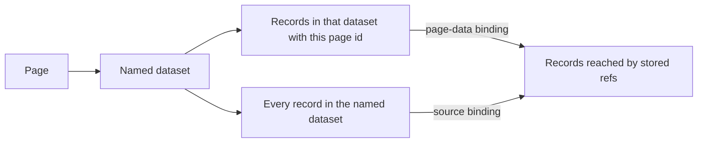

# Next-generation datasets — plan & constraints

**Status (March 2026):** The core model, editor (schema + records), bindings (page-data roots, ref walk, filters), built-in table/cards/list views, drill-down, and in-place migration on load are **implemented**. Items under [Parked](#parked) are not scheduled. [GUIDE.md](../GUIDE.md) and [ARCHITECTURE.md](../ARCHITECTURE.md) may lag this doc on field kinds and behaviour—update them when author-facing copy should match code.

This file is the canonical constraint skeleton (copied from the Cursor plan `dataset_skeleton`). Change decisions here first, then reflect them in SPEC/ARCHITECTURE/GUIDE as needed.

Related: [SPEC § datasets](../SPEC.md#datasets), [runtime modules](./runtime-modules.md).

---

## Roles

Schemas are an admin concern. Entering and editing records is for lower-level site authors. Authors use the record UI. They are not asked to edit the schema, and they are not expected to maintain the model by hand in JSON. Raw JSON stays available.

How technical those authors are beyond that, and which admin tasks exist besides schema edits, is still open.

## Constraints already stated

- Published data stays static. No request-time server reads or writes for dataset content. Flatten, preview, and publish prepare the bytes, as they do today.
- Datasets stay small. Size is not a reason to add a database.
- Some datasets are site-wide and may show on many pages. Some records are page-scoped.
- There will be a schema UI and a record UI. Raw JSON must be available. The form and grid must cover the model so raw JSON is an escape hatch.
- Some built-in rendering must show the data, including nested values. Most real presentation is expected to move to dynamically loaded modules. The current runtime-module mount can carry the first of that. Replacing it is out of this skeleton.
- Client consumption starts as JSON already in the published document. IndexedDB is not part of the plan.
- Datasets do not replace pages, articles, items, or the library in the early phases. Using datasets to augment those, and a client API that exposes nav and pages as data, are later questions.

## Prior baseline (superseded)

What Tessera shipped before the in-place upgrade—not the target design.

- One JSON file per dataset under `datasets/`: schema, view prefs, `nextUid`, and a flat `records` array.
- Field kinds were mostly flat scalars; `many` only on assets; no `object` kind.
- Visitors never fetch `datasets/*.json`. Bindings embed snapshots into `SiteDocument.datasets`, including datasets reached through `ref`.
- A row that needs its own URL is a page, not a dataset record ([SPEC.md](../SPEC.md)). That boundary stays until you explicitly change it.

## Decided

### Where bytes live

No dataset bytes live in page content. A page never becomes the schema host.

Page scope is a reference to an existing page id. There is no extra cross-reference layer.

A record stores a page id only when that page is the only page the record relates to. If more than one page needs the record, the record stores no page id, and each page selects the records itself (a binding filter, or a walk from other records).

Only a top-level record may carry that exclusive page link. Nested object values are not records: they have no `uid`, and they do not store a page id. A page does not pick nested objects out of a parent record. The link is optional system metadata beside `uid`, in the same way `added` and `modified` sit outside the schema today. The value is a page id, or empty. It is not a schema field: a schema field can be forgotten, made a collection, or pointed at a dataset. The rule is narrower than that. Zero or one page, only when the relationship is exclusive, and always a page id.

The other direction is a lookup, not a copy. A page-data binding names one dataset and lists the top-level records in that dataset whose own page id is the current page. It does not search inside objects. The bytes stay in the dataset.

Records also relate to records, including back and forth. A page is given the joined records it needs. Two pages may arrive by different starting records and still receive the same set. In that payload each record appears once, identified by dataset plus integer id. Referenced records are not deep-copied into the parent. Deep-copying would duplicate shared records and cannot represent a cycle.

### Shape of a schema

A dataset schema mixes inline objects and references.

Field kinds:

- Simple: `string` (single-line plain text), `text` (rich body like Compose—stored HTML, sanitized + markdown links on the site), `number`, `date`, `boolean`, `html` (raw HTML editor), `enum`, `asset`, `url`.
- `ref`. Each value points at one record in a named dataset. That dataset may be this one or another. A collection of refs is still one field.
- `object`, an inline subtype. Its fields may be any simple kind or `ref`. They may not be `object`.

`html` is edited with the full HTML editor. `text` uses the Compose-style rich editor (bold, links, lists, `pre.tessera-pre` code blocks). `enum` is a list of allowable strings. `asset` is a library reference. `enum` values are the strings themselves. Separate display labels are not part of the kind.

Nesting stops at one level, so the schema and record editors stay finite. An object subtype is defined inline on the field that uses it. It is not a named type in a registry. If two fields need the same nested shape, the field list is duplicated. If a shape must be shared or pointed at, it is its own dataset and a ref. That is the flexibility you gave up on purpose.

Every field is either one value or a collection. That includes simple fields, refs, and subtype fields. Cardinality is separate from kind (`many` on any field).

This bound is enough to keep the editors maintainable, provided three consequences stay with it:

- The schema UI is a two-level form. It is not a recursive type builder.
- The record dialog has a fixed set of widgets: single simple, simple list, single ref, ref list, one subtype, and a list of subtypes. Inside a subtype, only the first four appear. The page id control is on the root record only. The grid edits top-level single simple values and shows ref labels. Lists of subtypes are edited in the record dialog, not in the grid. Spreadsheet editing of nested collections is the part that would make this hard, and it is out.
- A ref is shown in the editor as the target’s label. The target record is not pasted into the form. That is what stops a self-ref from turning the form into a tree.

A list of subtypes whose fields are themselves lists is the most awkward dialog, and it is still one known widget. Arbitrary depth is the version that is not worth building.

Subtype values are not records. They have no integer id, and nothing can ref them. Order is the array order. A value that must be referenced is promoted to a record in a dataset.

### References and identity

A ref stores the target record’s integer id and the target dataset named by the field. The target may be a different dataset or the same dataset. A family tree is a same-dataset ref, not a nested subtype. Nesting would copy people into their parents, cannot share one child between two parents, and cannot cycle. Children of a person are the lookup “who points at me,” not a second stored field.

The editor may offer a picker of existing records. It stores the integer and shows the target’s label. It does not paste the target into the form, and it does not write the opposite link on the other record. If the target is missing, the value stays stored and rendering copes. Save is not rejected. There is no foreign-key cascade. Cycles are legal data. Two stored directions may disagree.

The editor shows a ref as the target’s label. A visible top-level ref column on the site does the same. The drill-down dialog lists the referenced records in a table. See Rendering.

Record identity is a non-reused incrementing integer. `nextUid` lives with the records. One user edits a dataset at a time, which is what makes that counter safe. Gaps after delete are expected.

Ids are for records only. Subtype rows do not get them.

### One file

Each dataset is one JSON file: schema, view prefs, `nextUid`, and records.

An author save may change records and `nextUid`. It may not change the schema. An admin save may change the schema and rewrite records to match, as `adaptRecords` does today. Authors share the file on disk and do not share the schema screen.

A second file stays out. It would pay off only if schema diffs must be reviewed apart from record diffs, or if one schema must govern several datasets. Neither is a current requirement.

### What a binding receives

Every binding of this kind names a dataset. The name is what keeps page data to one schema.

- **Page data.** The roots are the top-level records in that dataset whose own page id is the current page. A page id is not read from inside an object, and a nested object is never a root of its own.
- **Source dataset.** The roots are every record in that dataset.

The walk follows stored `ref` fields on those roots, including refs inside objects and collections, until no unused ref remains. A record already in the set is not entered again. A dangling ref ends that step. Each reached record appears once, keyed by dataset id plus `uid`. Object values stay inside their parent. Targets are not copied into the parent.

The walk follows stored refs only. A record that merely points at a reached record is not added, unless some stored ref on an included record points back at it. The product still does not keep a pair of ref fields in sync.

The browser assembles the walk. Publish embeds the dataset snapshots the walk can enter. It does not write a joined copy. At this size the walk is a small in-memory pass over data already loaded with the page. Painting the table costs more than the walk. One copy of each snapshot can serve every binding on the page.

A first-pass binding filter may name only a simple top-level field: `string`, `text`, `number`, `date`, `boolean`, `html`, `enum`, `asset`, or `url`. It may not name a `ref`, an `object`, or a field inside an object. The existing filter operations stay. Filter, sort, and limit apply to the roots a table or card lists.

A runtime-module binding receives the raw records, not the table projection. That is the selected roots with every field intact, plus the records the walk reaches. The binding also passes the dataset name. The module may ignore the name. It is not limited to the built-in filter language.

Built-in table, cards, list, and drill-down views resolve `data-tessera-page` anchors in rich `text` HTML at **render/publish** via the same `resolvePageRefs` pass as compose prose (`document.pages` + `hrefForPage`). That HTML is baked into the mount payload before the client paints it.

Runtime modules do not get that pass today. Raw field values still store `<a data-tessera-page="…" href="#">` (or markdown-expanded equivalents). A module that renders `text` or `html` itself must resolve links, or the mount spec must carry resolved HTML or a page id → href map at render time.

### Rendering

Tables and cards list the binding’s root records. They differ only in layout. A table is one row per record and one column per top-level field. A card is one card per record, with a bullet per top-level value. Both keep the current extras around that layout: visible columns, sort, limit, filters, empty text, a top-level `ref` shown as the target label, and the current `asset` and `url` markup.

The row and the card do not expand object fields or the records a ref points at. When a record has object or ref data, a drill-down icon opens one dialog. The dialog shows that record’s top-level fields in a detail layout, then one table per object field and one table per ref field. An object table lists the subtype rows. A ref table lists the referenced records. A single value is a one-row table. The dialog stops there. It does not open another drill-down on the related records. The layout is fixed.

The plain-list presentation still ships in code but is **not** part of this design long term (see Parked).

## Build approach

Decided: replace the current dataset model and the current schema and data screens. There is no `dataset2` file, second nav entry, or second binding type.

The editor surface is already the right size: [`apps/editor/src/datasets/schema-form.ts`](../apps/editor/src/datasets/schema-form.ts), [`record-form.ts`](../apps/editor/src/datasets/record-form.ts), and [`grid.ts`](../apps/editor/src/datasets/grid.ts), plus the model in [`packages/model/src/dataset.ts`](../packages/model/src/dataset.ts). The store, the `datasets/<id>.json` file, publish embedding, and the Datasets and Data navigation stay.

Old files load through an adapter on read. Legacy shapes are rewritten when an admin saves a schema (`adaptRecords`). Examples: asset `many` becomes field cardinality; enum labels collapse to values.

A parallel dataset2 would fork the parser, the embed path, the binding, and the author screen. The end-to-end result would be a second product beside the one sites already use.

### Code map (implemented)

| Area | Location |
|------|----------|
| Model, validation, display | [`packages/model/src/dataset.ts`](../packages/model/src/dataset.ts), [`dataset-walk.ts`](../packages/model/src/dataset-walk.ts), [`dataset-query.ts`](../packages/model/src/dataset-query.ts) |
| Editor schema + records | [`apps/editor/src/datasets/`](../apps/editor/src/datasets/) |
| Binding wizard | [`apps/editor/src/forms/dataset-binding.ts`](../apps/editor/src/forms/dataset-binding.ts) |
| Site table/cards/list + drill-down | [`packages/extras/src/dataset-present.ts`](../packages/extras/src/dataset-present.ts), [`dataset-payload.ts`](../packages/extras/src/dataset-payload.ts), [`dataset-drilldown.ts`](../packages/extras/src/dataset-drilldown.ts) |
| Runtime module raw payload | [`packages/extras/src/runtime-module-present.ts`](../packages/extras/src/runtime-module-present.ts) |

## Parked

Nothing here is a question for this skeleton. Each item waits until you choose to take it up.

- Another built-in presentation besides tables, cards, and the fixed drill-down dialog. The current plain list is not part of this pass (may be removed later).
- Whether raw JSON in the editor is the whole dataset file, one record, or both. Raw JSON stays available. The scope is unset.
- When runtime modules are no longer enough.
- Datasets augmenting pages, articles, items, or the library, and a client API that treats nav and pages as data.
- **Page links in runtime-module dataset data.** Catalogue dataset views already resolve `data-tessera-page` at render/publish into real `href`s in the embedded payload. Runtime-module bindings pass **raw** walked records; `text` / rich HTML there is unchanged. Longer term: either resolve page refs when building the runtime mount spec (same `document.pages` + `hrefForPage` as bindings), or pass a small page index alongside raw data so the module can resolve in the browser without duplicating nav-only lists.

## Next slice

The page-data listing and the built-in drill-down are settled. There is no open question blocking the skeleton. Follow-up work is mostly parked items, author/docs alignment, and runtime-module page-link resolution.
